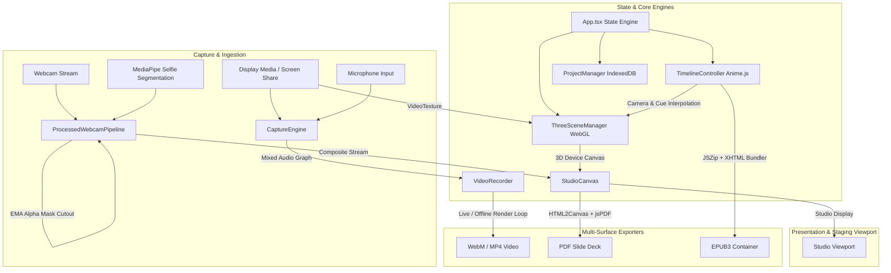
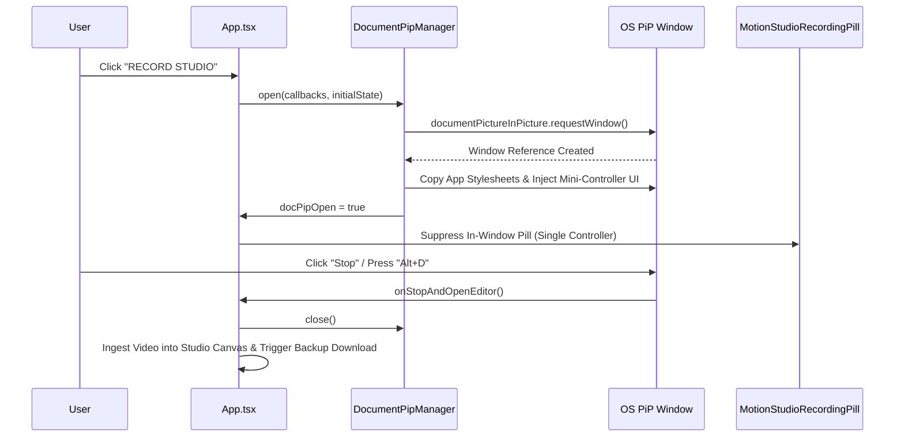

# MotionStudio Architecture Blueprint

This document details the software architecture, compositing pipelines, state management, and multi-surface export systems of **MotionStudio (Savazai-Presenter)**.

---

## 1. Architectural Philosophy & Constraints

- **100% Client-Side Execution**: Zero backend server dependencies. Video encoding, 3D WebGL rendering, neural selfie segmentation, Web Audio graph routing, PDF generation, and EPUB3 container serialization execute entirely inside the client browser.
- **Port Mandate**: All local development and production containers bind strictly to **Port 9090** (`0.0.0.0:9090`).
- **Unidirectional Data Flow**: State flows cleanly from the root state engine in `App.tsx` down to specialized coordinators (`ThreeSceneManager`, `TimelineController`, `ProcessedWebcamPipeline`, `CaptureEngine`, `ProjectManager`).

---

## 2. High-Level System Architecture



---

## 3. Subsystem Breakdown

### 3.1 ThreeSceneManager (WebGL 3D Staging Engine)
- **Location**: `src/core/scene/ThreeSceneManager.ts`
- **Responsibilities**:
  - Manages Three.js `WebGLRenderer` with `preserveDrawingBuffer: true` to prevent green-screen encoding drops.
  - Builds and positions 3D physical device models (MacBook Pro with display bezel, iPhone chassis, iMac, and Frameless Clean flat plane).
  - Dynamically binds live `<video>` streams to an internal `THREE.VideoTexture` using `THREE.SRGBColorSpace`.
  - Coordinates camera positioning, field of view (FOV), yaw/pitch rotations, and spring-based focus animations.

### 3.2 ProcessedWebcamPipeline & Segmentation
- **Location**: `src/core/capture/ProcessedWebcamPipeline.ts`
- **Architecture**:
  - **Layer 0 (Background)**: Virtual office image texture, blur filter, or mesh gradient.
  - **Layer 1 (Subject Cutout)**: MediaPipe Selfie Segmentation mask smoothed via Exponential Moving Average (EMA) alpha filtering ($\alpha = 0.35$).
  - Rendered using canvas `globalCompositeOperation = 'source-in'` to cleanly isolate presenter contours without tearing during rapid head movements.

### 3.3 CaptureEngine & Web Audio Mixer
- **Location**: `src/core/capture/CaptureEngine.ts`
- **Graph Topology**:
  - `MicrophoneStream -> MediaStreamAudioSourceNode -> MicGainNode -> MasterGainNode -> MediaStreamAudioDestinationNode`
  - `DisplayStream -> MediaStreamAudioSourceNode -> DisplayGainNode -> MasterGainNode`
  - Real-time `AnalyserNode` computes RMS / VU power levels for pre-recording audio calibration.
  - Prioritizes physical audio hardware over virtual utility drivers (`AI Noise-cancelling`, `Steam Streaming Microphone`).

### 3.4 VideoRecorder (Deterministic & Live Exporter)
- **Location**: `src/core/exporters/VideoRecorder.ts`
- **Modes**:
  1. **Live Recording Mode**: Combines the offscreen canvas render stream with the mixed Web Audio stream into a browser `MediaRecorder` instance (VP9/VP8 WebM).
  2. **Deterministic Offline Mode**: Steers the `TimelineController` seek head tick-by-tick (`requestAnimationFrame`), forcing Three.js canvas redraws for flawless 60 FPS offline renders without dropped frames.

### 3.5 TimelineController (Kinematics & Cue Sequencing)
- **Location**: `src/core/timeline/TimelineController.ts`
- **Engine**: Anime.js timeline coordinator governing:
  - Slide chapter timestamps and cue points.
  - Kinetic typography callouts, badges, and cursor animations.
  - Dynamic camera transitions, zoom keyframe fragments, and playback speed scaling.

### 3.6 ProjectManager (IndexedDB Local Store)
- **Location**: `src/core/projects/ProjectManager.ts`
- **Schema**:
  - `id`: Unique project identifier.
  - `name`: Project title.
  - `videoBlob`: Binary recording payload.
  - `settings`: Serialized wallpaper, 3D mockup configs, PiP coordinates, zoom fragments, and callouts.
  - `updatedAt`: Auto-save timestamp.

---

## 4. Document Picture-in-Picture (PiP) Flow



---

## 5. Security, Sandboxing & Headers

To support high-resolution offscreen rendering and high-precision timers without CORS restrictions, the Vite and Docker production servers deliver:

```http
Cross-Origin-Opener-Policy: same-origin
Cross-Origin-Embedder-Policy: credentialless
```

- **Zero External Telemetry**: No third-party analytics, remote tracking, or cloud video upload endpoints.
- **XSS Defense**: DOMParser sanitization on any dynamic text overlays or imported presentation templates.
